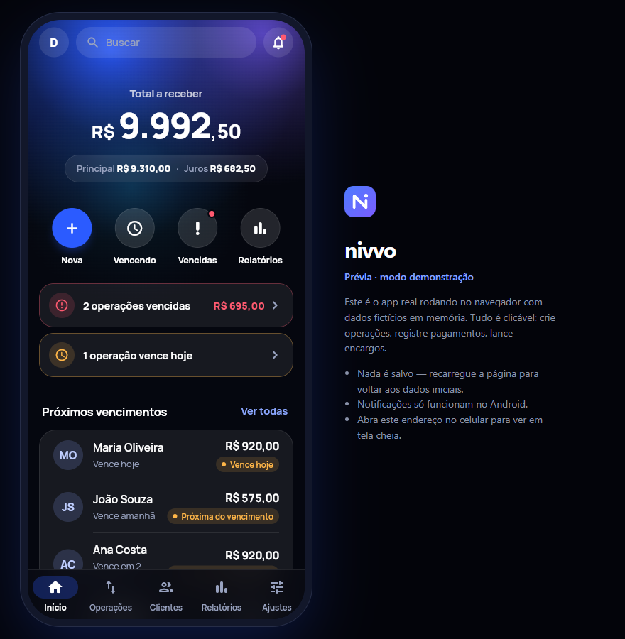
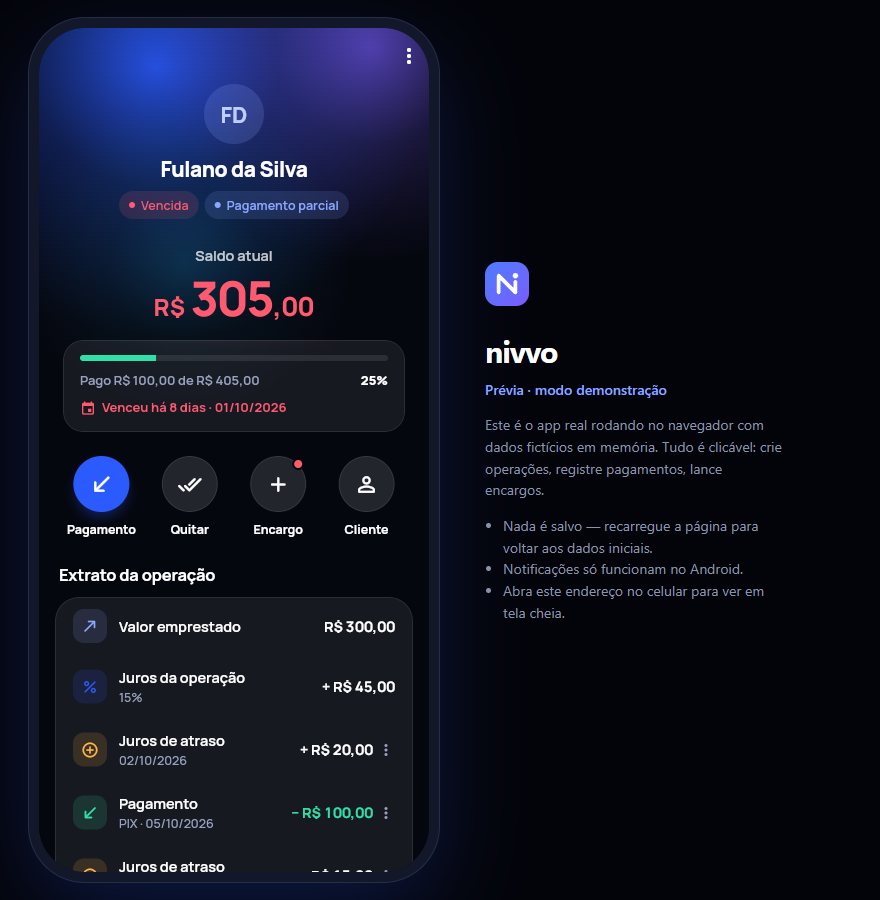
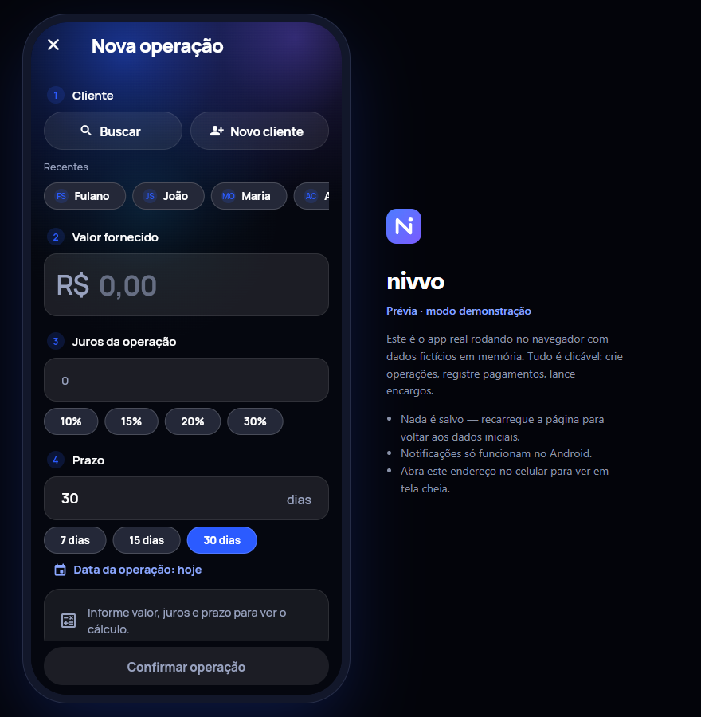
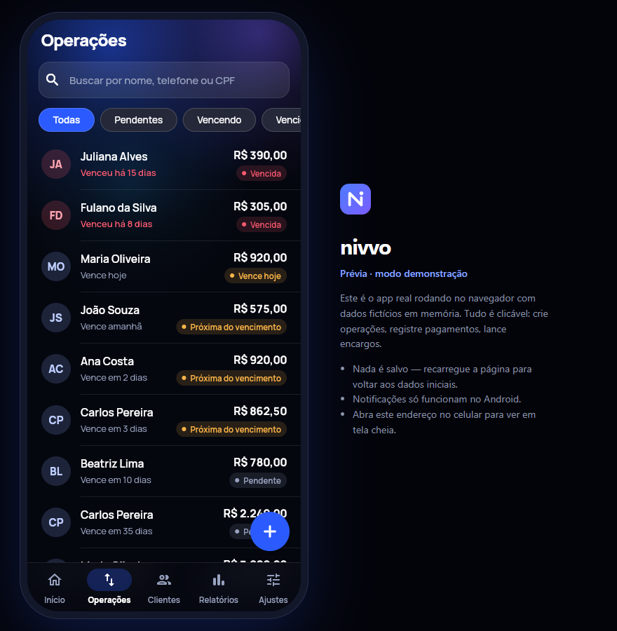

# Nivvo

**Controle financeiro simplificado.** App Android (Flutter) para registrar e acompanhar operações de
empréstimo: clientes, juros, vencimentos, encargos, pagamentos parciais, histórico e lembretes.
O dinheiro circula fora do app — o Nivvo é a camada de controle.

<p>
  
  
</p>
<p>
  
  
</p>

> Prévias do modo demonstração rodando no navegador (dados fictícios).

Decisões de arquitetura, segurança e regras financeiras: [docs/ARQUITETURA.md](docs/ARQUITETURA.md).

## Stack

Flutter 3.47 · Dart 3.13 · Material 3 (`material_ui`) · fonte Manrope (OFL) · Riverpod 3 · go_router 18 · Supabase (Auth + PostgreSQL + RLS) ·
notificações locais agendadas.

## Como rodar

### 1. Supabase

1. Crie um projeto em [supabase.com](https://supabase.com).
2. Rode a migration [supabase/migrations/20261008000000_init.sql](supabase/migrations/20261008000000_init.sql):
   - pelo **SQL Editor** do painel (cole o arquivo inteiro e execute), ou
   - pela CLI: `supabase link --project-ref <ref>` e `supabase db push`.
3. Em **Authentication → URL Configuration → Redirect URLs**, adicione:
   `com.nivvo.app://auth-callback`
   (usado pela confirmação de e-mail e pela recuperação de senha).
4. Em **Project Settings → API Keys**, copie a URL e a chave **publishable** (ou `anon`).
   **Nunca** use a chave `service_role`/secret no app.

### 2. App

```bash
cp env.example.json env.json        # preencha URL e chave
flutter pub get
flutter run --dart-define-from-file=env.json
```

Build de release: `flutter build apk --release --dart-define-from-file=env.json`
(configure antes uma chave de assinatura própria em `android/app/build.gradle.kts`).

## Prévia no navegador (sem Supabase, sem emulador)

O **modo demonstração** roda o app real com dados fictícios em memória (mesmas regras financeiras do banco):

```bash
flutter run -d chrome --dart-define=DEMO=true            # desenvolvimento, com hot reload
# ou gerar e servir a versão compilada:
flutter build web --release --dart-define=DEMO=true --no-web-resources-cdn
python -m http.server 8080 --directory build/web         # abra http://localhost:8080
```

No computador o app aparece numa moldura de celular; no celular (mesma rede Wi-Fi,
`http://IP-DO-PC:8080`) ocupa a tela inteira. Nada é salvo — recarregar volta aos dados iniciais.

## Retomar o projeto em outro computador

O repositório tem todo o código. Ficam **fora do Git**, por segurança, e precisam ser recriados:

1. **`env.json`** — copie `env.example.json` e preencha com a *Project URL* e a *Publishable key*
   do Supabase (Project Settings → API Keys). O banco já está criado no Supabase; não rode a
   migration de novo.
2. **Chave de assinatura Android** (só para gerar APK de release) — crie com
   `keytool -genkeypair -keystore nivvo-release.jks -storetype PKCS12 -alias nivvo -keyalg RSA -keysize 4096 -validity 10000`
   e um `android/key.properties` com `storeFile`, `storePassword`, `keyAlias` e `keyPassword`.
   Guarde a chave com backup: atualizações do app instalado exigem a mesma chave.
3. Ferramentas: Flutter 3.47+, JDK 21 e Android SDK (Android Studio ou command-line tools
   **versão 19.0** no Windows — a 20+ quebra a instalação do NDK). Reserve ~10 GB livres em disco.
4. APK: `flutter build apk --release --target-platform android-arm64 --dart-define-from-file=env.json`

## Testes

```bash
flutter test                          # regras financeiras, extrato, linha do tempo, lembretes
cd supabase/tests && npm install && npm test   # migration em Postgres real (PGlite): RLS, RPCs, isolamento
```

## Estrutura

```
lib/
  core/            regras puras: finance/ (juros, saldo, status), money/, utils/, cache/, errors/, config/
  features/        auth, dashboard, loans, clients, payments, charges, reports, settings, notifications
  shared/          models/, repositories/ (acesso ao Supabase), services/ (providers base), widgets/
  routing/         go_router + shell com navegação inferior
  theme/           paleta, tema claro/escuro
supabase/
  migrations/      schema, RLS, funções RPC atômicas
  tests/           teste da migration
docs/              arquitetura e prévias das telas
```

Regras de dinheiro: valores sempre em **centavos inteiros** no app e `numeric(14,2)` no banco.
Toda escrita financeira passa por funções SQL transacionais — o app não tem permissão de alterar
saldos diretamente.

## Próximos passos sugeridos

- Ícone do launcher em PNG para Android < 8 (o ícone adaptativo vetorial já cobre Android 8+).
- Push remoto (FCM + Edge Function) usando a tabela `notifications`, quando houver vários aparelhos.
- Exportação PDF/Excel, renegociação e parcelas (a arquitetura já prevê — ver `docs/ARQUITETURA.md`).
